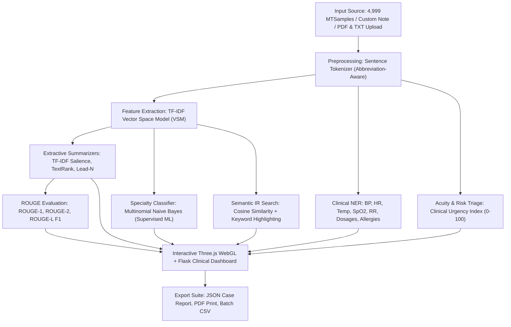

# 🏥 MediMine AI — 3D Clinical Intelligence & Text Mining Platform

[](https://www.python.org/)
[](https://flask.palletsprojects.com/)
[](https://threejs.org/)
[](https://scikit-learn.org/)
[](https://www.kaggle.com/datasets/tboyclk/medical-transcriptions)
[](LICENSE)

An enterprise-grade, interactive clinical text mining and decision support system built on **4,999 actual medical transcriptions** from the MTSamples corpus. MediMine AI combines **Three.js 3D WebGL knowledge graphs**, **Extractive Summarization (TF-IDF & TextRank)**, **Named Entity Recognition (NER)**, **Supervised ML Classification (Naive Bayes)**, **Vector Space Information Retrieval (Cosine Similarity)**, and **Big Data Analytics** into a unified, responsive clinical web dashboard.

---

## 📌 Project Overview

- **Institution**: University of Debrecen (Faculty of Informatics)
- **Course**: Text and Web Mining (3rd Semester)
- **Platform**: MediMine AI Clinical Intelligence
- **Corpus**: 4,999 Real-world Medical Transcriptions across 40 Medical Specialties

---

## 🌟 Key Features

### 1. 🌐 3D Interactive WebGL Knowledge Graph (Three.js)
- Real-time 3D orbital synapse rendering medical specialties as dynamic interactive nodes.
- Raycasting interaction: clicking any 3D node automatically spotlights and loads clinical records for that specialty.
- Fully controllable auto-rotation, smooth zoom, and camera reset.

### 2. ⚡ Multi-Algorithm Extractive Summarization
- **TF-IDF Salience (Length-Normalized)**: Scores sentences by vector magnitude normalized by word length to prevent sentence length bias.
- **TextRank (Graph-based PageRank)**: Builds sentence co-occurrence graphs using Jaccard/overlap weights and computes eigenvector centrality to extract core clinical ideas.
- **Lead-N Baseline**: Standard extractive benchmark for clinical SOAP and H&P notes.
- Dynamic summary length configuration (3, 4, or 5 key clinical sentences).

### 3. 🩺 Clinical Named Entity Recognition (NER) & Vitals Extraction
- Extracts quantitative patient vitals: **Blood Pressure (BP)**, **Heart Rate / Pulse**, **Body Temperature**, **Oxygen Saturation (SpO2)**, **Respiratory Rate (RR)**, and **Weight/BMI**.
- Detects **Prescriptions, Dosages, Frequencies** (e.g., *Lisinopril 20 mg daily*).
- Flags **Allergies & Adverse Drug Reactions (ADR)**.
- Extracts patient demographics (age, gender, clinical status).

### 4. 🚨 Clinical Acuity & Urgency Risk Triage
- Automated triage heuristic scoring from **0 to 100**.
- Classifies patient acuity into:
  - 🟢 **Routine / Low Acuity** (0–24)
  - 🟡 **Moderate / Semi-Urgent** (25–49)
  - 🟠 **High Acuity / Urgent** (50–74)
  - 🔴 **Emergency / Immediate Resuscitation** (75–100)
- Triggers alert badges and recommendations based on clinical keywords (e.g., *infarction, shock, hemorrhage, acute respiratory failure*).

### 5. 🏷️ Supervised Department Classifier (Multinomial Naive Bayes)
- Trained on the 4,999 MTSamples corpus across medical specialties.
- Predicts medical specialty for unlabelled consultation notes and prescriptions.
- Visualizes confidence probability distribution via **Chart.js**.

### 6. 🔎 Vector Space IR Engine (Information Retrieval)
- Full-corpus TF-IDF matrix with **Cosine Similarity** ranking.
- Specialty filtering to search within specific departments or cross-corpus.
- In-text search term keyword highlighting (`<mark class="query-mark">`).
- Similarity score percentage matching.

### 7. 📊 Big Data Analytics & Corpus Insights
- Departmental case distribution with interactive Chart.js bar and donut charts.
- Corpus vocabulary statistics, average note length, and specialty clustering.

### 8. ⚡ Concurrent Batch Processing Engine
- Batch summarization across multiple patient notes simultaneously.
- One-click export to **CSV Spreadsheet** for batch analysis.

### 9. 📂 Smart File Drag-and-Drop Ingestion
- Upload `.txt` or `.pdf` clinical documents.
- Server-side text extraction using `pypdf` with instant mining analysis.

### 10. 📈 Scientific Performance Evaluation (ROUGE Metrics)
- Computes **ROUGE-1**, **ROUGE-2**, and **ROUGE-L** F1-scores against source transcripts.
- Calculates exact compression ratios and time saved in reading.

### 11. 📤 Clinical Export Suite
- **Copy to Clipboard** with formatted markdown.
- **Export JSON** clinical case file.
- **Print / PDF** medical summary report.

---

## 🏗️ System Architecture & Workflow



---

## 📁 Repository Structure

```
├── data/
│   └── medical_transcriptions.csv    # 4,999 MTSamples clinical dataset (17 MB)
├── outputs/                          # Dynamic summaries and batch exports
├── static/
│   ├── index.html                    # Single-Page Web Dashboard (Three.js + Vanilla CSS)
│   └── vendor/
│       ├── three.min.js              # Three.js WebGL 3D library
│       ├── OrbitControls.js          # Orbital camera controls
│       └── chart.umd.min.js          # Chart.js charting engine
├── text_miner.py                     # NLP & ML Engine (TF-IDF, TextRank, Naive Bayes, NER)
├── server.py                         # Production Flask REST API backend
├── app.py                            # CLI / Terminal Batch Mining Script
├── requirements.txt                  # Python dependencies
├── run.bat                           # 1-Click Windows execution script
├── SYSTEM_WORKFLOW.md                # System Architecture specification
└── README.md                         # Project documentation
```

---

## 🚀 Quick Start Guide

### Prerequisites
- Python 3.9, 3.10, or 3.11
- Git

### 1. Clone the Repository
```bash
git clone https://github.com/cmtimran/Text-and-Web-Minning.git
cd Text-and-Web-Minning
```

### 2. Set Up Virtual Environment (Recommended)
```bash
# Windows
python -m venv venv
venv\Scripts\activate

# macOS / Linux
python3 -m venv venv
source venv/bin/activate
```

### 3. Install Dependencies
```bash
pip install -r requirements.txt
```

### 4. Run the Application

#### Option A: Web Platform (Flask + Three.js)
```bash
python server.py
```
Open your browser and navigate to:
```
http://localhost:5000/
```

#### Option B: Terminal / CLI Batch Mining
```bash
python app.py
```

#### Option C: Windows 1-Click Launch
Double-click `run.bat` in the root folder.

---

## ☁️ Deployment

### Deploy to Render.com (Recommended Free Hosting)
1. Sign up on [Render.com](https://render.com).
2. Click **New +** -> **Web Service**.
3. Connect your GitHub repository: `cmtimran/TextandWebMinning`.
4. Configure settings:
   - **Environment**: `Python 3`
   - **Build Command**: `pip install -r requirements.txt`
   - **Start Command**: `python server.py`
5. Click **Deploy Web Service**!

### Deploy to Railway.app
1. Go to [Railway.app](https://railway.app).
2. Click **New Project** -> **Deploy from GitHub repo**.
3. Select `TextandWebMinning`.
4. Railway will auto-detect `requirements.txt` and generate your public URL.

---

## 🔬 NLP & Machine Learning Specifications

| Component | Technical Implementation |
| :--- | :--- |
| **Vector Space Model** | TF-IDF (`TfidfVectorizer`, sublinear TF scaling, English stopwords) |
| **Graph Centrality** | TextRank PageRank with Sentence Co-occurrence cosine weights |
| **Supervised Classifier**| Multinomial Naive Bayes (`alpha=1.0`) with Laplace smoothing |
| **Similarity Metric** | Cosine Similarity on L2-normalized sparse TF-IDF vectors |
| **Scientific Validation**| Google ROUGE Score (`rouge-score` library: ROUGE-1, ROUGE-2, ROUGE-L) |
| **3D Rendering** | Three.js WebGL Particle Sphere with raycaster event picking |

---

## 👨‍💻 Author & Academic Credit

- **Student / Developer**: Imran Hossain ([@cmtimran](https://github.com/cmtimran))
- **Program**: Computer Science MSc
- **University**: University of Debrecen, Hungary
- **Course**: Text and Web Mining

---

## 📄 License

This project is licensed under the MIT License - see the [LICENSE](LICENSE) file for details.