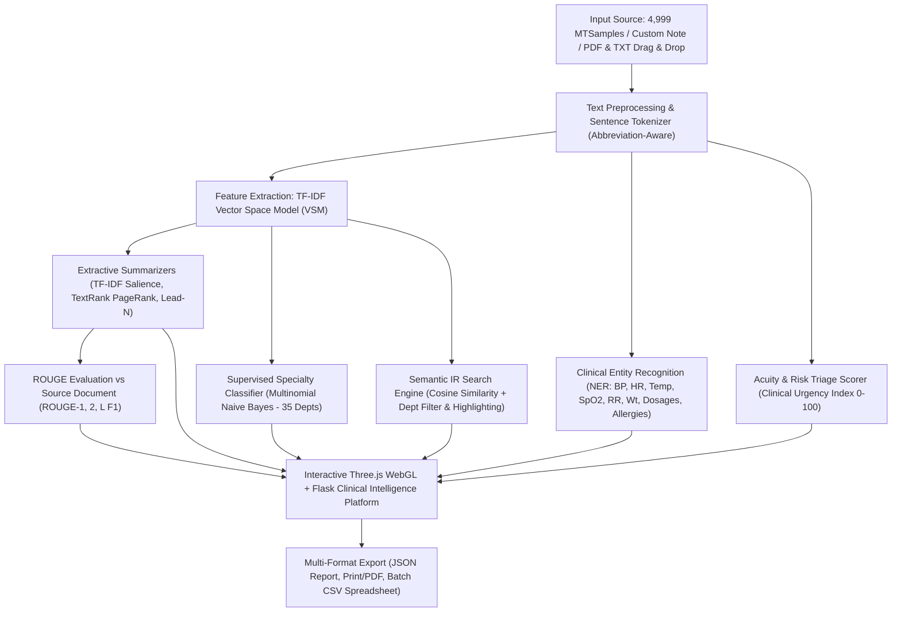

# 🏥 MediMine AI - System Architecture & Workflow

## 📊 End-to-End System Diagram (Mermaid)

---

## 🛠️ মডিউল অনুযায়ী আর্কিটেকচার বিবরণ

| মডিউল | ইনপুট | ব্যবহৃত অ্যালগরিদম / মেথড | চূড়ান্ত আউটপুট |
| :--- | :--- | :--- | :--- |
| **১. Data Ingestion & Preprocessing** | 4,999 MTSamples CSV / Custom Text / PDF & TXT Upload | Abbreviation-Aware Tokenization & PyPDF | ক্লিন সেন্টেন্স ও ওয়ার্ড টোকেন |
| **২. Feature Extraction** | সেন্টেন্স ও ডকুমেন্ট কর্পাস | TF-IDF Vector Space Model (VSM) | Sparse TF-IDF Feature Matrix |
| **৩. Extractive Summarization** | TF-IDF Matrix & Co-occurrence Graph | TF-IDF Salience, TextRank (PageRank), Lead-N | ৩-৫ লাইনের গুরুত্বপূর্ণ ক্লিনিক্যাল সারাংশ |
| **৪. Named Entity Recognition (NER)** | ক্লিনিক্যাল নোট | Clinical Pattern Matching (Rule-based) | BP, HR, Temp, SpO2, RR, Weight, Dosages, Allergies |
| **৫. Semantic IR Search Engine** | ডাক্তারের সার্চ কুয়েরি + ডিপার্টমেন্ট ফিল্টার | Cosine Similarity across 4,999 records | প্রাসঙ্গিকতার শতাংশ (%) ও টার্ম হাইলাইট সহ কেস স্টাডি |
| **৬. Medical Specialty Classifier** | নতুন প্রেসক্রিপশন টেক্সট | Multinomial Naive Bayes (Supervised ML - 35 Depts) | প্রেডিক্টেড ডিপার্টমেন্ট ও কনফিডেন্স প্রোবাবিলিটি চার্ট |
| **৭. Acuity & Risk Triage Scorer** | ক্রিটিক্যাল মেডিকেল মার্কার | Clinical Urgency Heuristic (0-100) | Routine, Moderate, High/Critical Risk লেভেল |
| **৮. Performance Evaluation** | সোর্স টেক্সট বনাম সামারি | ROUGE-1, ROUGE-2, ROUGE-L (F1 Scores) | বৈজ্ঞানিক ইভ্যালুয়েশন স্কোর (%) ও কম্প্রেশন রেট |
| **৯. Clinical Reporting & Export** | অ্যানালাইসিস রেজাল্টস ও ব্যাচ আউটপুট | Client-side File Generation | JSON Report, PDF Printout, Batch CSV Spreadsheet |

---
**প্রজেক্ট:** Text and Web Mining (University of Debrecen)  
**সিস্টেম:** MediMine AI 3D Clinical Intelligence Platform
